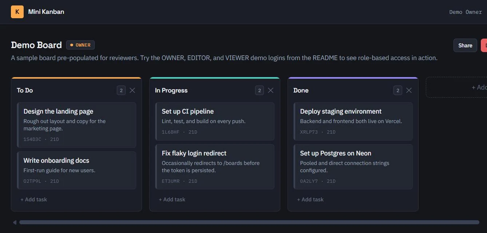
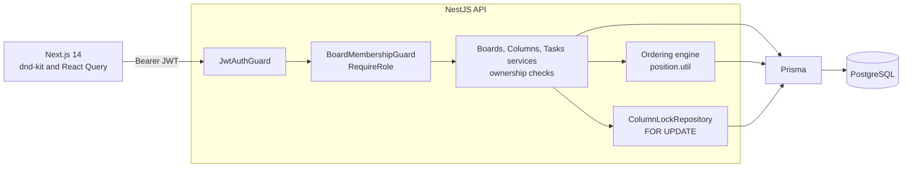
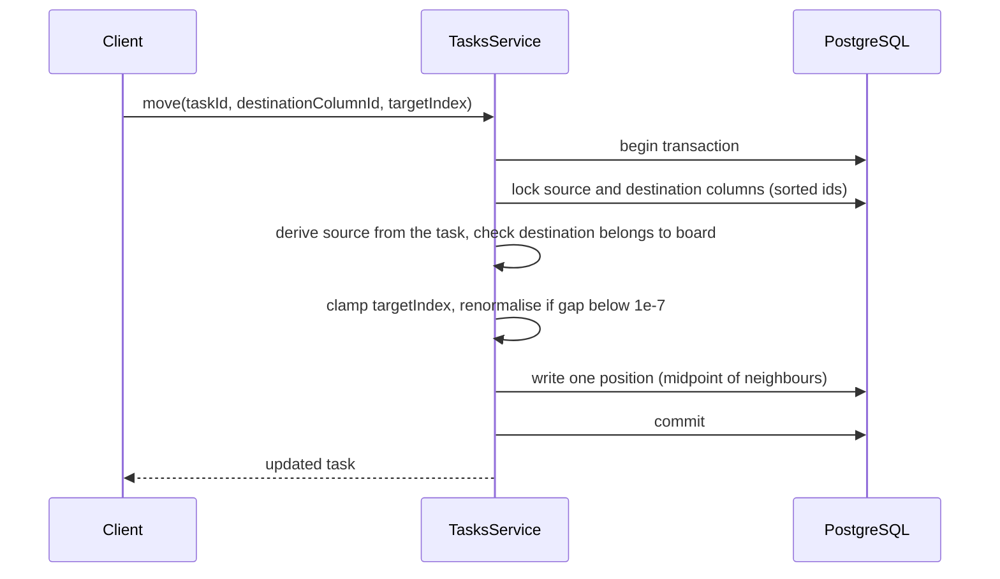

<div align="center">
  

  <p><code>Kanban boards with OWNER, EDITOR and VIEWER roles and drag-and-drop ordering that stays correct under concurrent moves</code></p>

  <p>
    <a href="https://mini-kanban-board-frontend.vercel.app"></a>
    <a href="https://mini-kanban-board-backend.vercel.app/docs"></a>
    <a href="https://github.com/Saji-d/mini-kanban-board"></a>
    
  </p>

  <p>
    
    
    
    
    
    
    
  </p>

  <p>
    <a href="#-overview">Overview</a> · <a href="#-try-it-live">Try it live</a> · <a href="#-highlights">Highlights</a> · <a href="#-preview">Preview</a> · <a href="#-architecture">Architecture</a> · <a href="#-tech-stack">Tech Stack</a> · <a href="#-getting-started">Getting Started</a> · <a href="#-roadmap">Roadmap</a>
  </p>
</div>


## ◈ Overview

Mini Kanban Board is a small Kanban app. Users register, create boards, share them with other registered users under an explicit **OWNER, EDITOR and VIEWER** role model and organise work across columns and tasks with drag-and-drop.

It was built for a technical assessment and leans hardest on two things:

1. **Order consistency:** the task-move API stays correct and cheap under concurrent and repeated reordering.
2. **Authorization:** every board, column and task mutation is checked against board membership and role, with defences against cross-board id tampering.


## ◈ Try it live

<div align="center">
  <a href="https://mini-kanban-board-frontend.vercel.app/login"></a>
</div>

<br>

Three demo accounts share one pre-populated **Demo Board** at every role, so you can compare the permission matrix right away. You can also register your own account, which makes you the OWNER of any board you create.

| Role | Email | Password | What to try |
| :--- | :--- | :--- | :--- |
| **OWNER** | `demo.owner@mini-kanban.app` | `MiniKanbanDemo1!` | Manage members, edit columns and tasks, delete the board |
| **EDITOR** | `demo.editor@mini-kanban.app` | `MiniKanbanDemo1!` | Create, edit and drag tasks. No membership controls |
| **VIEWER** | `demo.viewer@mini-kanban.app` | `MiniKanbanDemo1!` | Read only. Mutation controls are hidden and the API rejects them |

> These are shared demo accounts, so data may be reset. Please do not store anything personal.


## ◈ Highlights

<table>
<tr>
<td width="33%" valign="top"><b>Midpoint ordering</b><br>Dropping a task writes one row: the new position is the midpoint of its neighbours. No full re-sequencing.</td>
<td width="33%" valign="top"><b>Row-locked moves</b><br>Moves lock the source and destination columns with <code>SELECT ... FOR UPDATE</code> in sorted order to avoid deadlocks.</td>
<td width="33%" valign="top"><b>Auto renormalisation</b><br>If two positions get closer than <code>1e-7</code> the column is rewritten with even spacing inside the same transaction.</td>
</tr>
<tr>
<td valign="top"><b>Layered authorization</b><br>Global JWT guard, a board membership guard with role checks and service-level ownership checks.</td>
<td valign="top"><b>Cross-board safety</b><br>Task and column ids are verified against the board in the URL, which blocks id tampering across boards.</td>
<td valign="top"><b>Last owner protected</b><br>A board always keeps at least one OWNER. Demoting or removing the last one is rejected.</td>
</tr>
<tr>
<td valign="top"><b>Accessible drag and drop</b><br>Multi-container sortable lists with <code>@dnd-kit</code> and React Query for server state.</td>
<td valign="top"><b>Swagger docs</b><br>Interactive API docs served at <code>/docs</code>.</td>
<td valign="top"><b>40 tests</b><br>14 unit tests for the ordering utility plus 26 end-to-end tests for auth, the authorization matrix and ordering.</td>
</tr>
</table>


## ◈ Preview

<div align="center">
  
</div>


## ◈ Architecture



**Data model:** `User` to `Board` to `Column` to `Task`, plus a `BoardMember` join table with a `role`. The owner is also a `BoardMember` row with role `OWNER`, so every authorization check is one uniform membership lookup.

**Moving a task** (`PATCH /boards/:boardId/tasks/:taskId/move` with `destinationColumnId` and `targetIndex`):



<details>
<summary><b>Authorization matrix</b></summary>

| Operation | VIEWER | EDITOR | OWNER |
| :--- | :---: | :---: | :---: |
| Read board, columns, tasks and members | ✓ | ✓ | ✓ |
| Update board title and description | | ✓ | ✓ |
| Delete board | | | ✓ |
| Create, update and delete columns | | ✓ | ✓ |
| Create, update, delete and move tasks | | ✓ | ✓ |
| Add, change role and remove members | | | ✓ |

A non-member receives `404` rather than `403` for a board they cannot see, so responses cannot be used to probe which board ids exist.

</details>

<details>
<summary><b>API overview</b></summary>

All routes except `/health`, `/auth/register` and `/auth/login` require `Authorization: Bearer <token>`.

```text
POST   /auth/register
POST   /auth/login
GET    /boards                      POST   /boards
GET    /boards/:boardId             PATCH  /boards/:boardId      DELETE /boards/:boardId
GET    /boards/:boardId/members     POST   /boards/:boardId/members
PATCH  /boards/:boardId/members/:memberId    DELETE /boards/:boardId/members/:memberId
GET    /boards/:boardId/columns     POST   /boards/:boardId/columns
PATCH  /boards/:boardId/columns/:columnId    DELETE /boards/:boardId/columns/:columnId
GET    /boards/:boardId/tasks       POST   /boards/:boardId/tasks
PATCH  /boards/:boardId/tasks/:taskId        DELETE /boards/:boardId/tasks/:taskId
PATCH  /boards/:boardId/tasks/:taskId/move
```

</details>


## ◈ Tech Stack

| Layer | Technologies | Purpose |
| :--- | :--- | :--- |
| Frontend | Next.js 14 App Router, React, TypeScript, Tailwind CSS | Auth pages, boards list and Kanban view |
| Interaction | `@dnd-kit`, TanStack React Query | Drag and drop and server state |
| Backend | NestJS, TypeScript, class-validator DTOs | REST API with guards and Swagger |
| Database | PostgreSQL, Prisma | Relational model with migrations |
| Testing | Jest, Supertest | Unit and end-to-end suites on a separate test database |
| Delivery | Docker Compose, Vercel, Neon Postgres | Local stack and live deployment |


## ◈ Getting Started

**Prerequisites:** Docker, or Node.js 20 or newer with PostgreSQL 14 or newer.

Quick start with Docker:

```bash
git clone https://github.com/Saji-d/mini-kanban-board.git
cd mini-kanban-board
cp .env.example .env
docker compose up --build
# frontend http://localhost:3000, API http://localhost:3001, Swagger /docs
```

The backend container runs `prisma migrate deploy` on startup, so the schema is created for you.

<details>
<summary><b>Manual setup without Docker</b></summary>

```bash
# backend
cd backend
cp .env.example .env
npm install
npx prisma migrate deploy
npm run start:dev          # http://localhost:3001

# frontend (second terminal)
cd frontend
cp .env.example .env.local
npm install
npm run dev                # http://localhost:3000
```

Backend variable names: `DATABASE_URL`, `DIRECT_URL`, `JWT_SECRET`, `JWT_EXPIRES_IN`, `PORT`, `CORS_ORIGIN`. Frontend: `NEXT_PUBLIC_API_URL`.

</details>

Run the tests from `backend/`:

```bash
npm test             # unit tests for the ordering utility
npm run test:e2e     # auth, authorization matrix, ordering (uses the kanban_test database)
```


## ◈ Project Structure

<details>
<summary><b>Show the tree</b></summary>

```text
mini-kanban-board/
├── backend/
│   ├── prisma/            # schema and migrations
│   ├── src/
│   │   ├── auth/  boards/  columns/  tasks/  users/
│   │   └── common/        # guards, decorators, ordering/position.util
│   └── test/              # e2e suites
├── frontend/
│   └── src/
│       ├── app/           # (auth) and (dashboard) route groups
│       ├── features/      # board-detail, boards
│       └── components/ui/
└── docker-compose.yml
```

</details>


## ◈ Roadmap

- [x] Role-based sharing with layered authorization
- [x] Concurrency-safe task moves with midpoint ordering
- [ ] Drag-to-reorder for columns (only tasks can be moved today)
- [ ] Refresh-token rotation and revocation (access tokens only, 7-day expiry)
- [ ] Real-time sync between viewers of the same board


## ◈ Author

**Sajidur Rahman Sajid**, Full-Stack Developer and AI engineer from Dhaka.

[Portfolio](https://www.sajidur.me) · [LinkedIn](https://www.linkedin.com/in/sajidur-rahman-sajid/) · [GitHub](https://github.com/Saji-d) · [Email](mailto:sajidsajidurrahman99@gmail.com)

<div align="center"><sub>Built for a technical assessment and deployed end to end.</sub></div>
